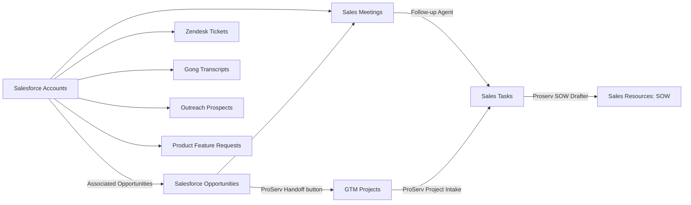

<callout icon="/icons/rocket_green.svg" color="gray_bg">
Deploys a new, self-contained copy of the <b>Customer Hub with AIMN</b> demo (the Lumi Labs video recorded in the GTM & Revops teamspace) into the current workspace, so it behaves like the video. <b>Every run creates a new private teamspace</b> named "\<first name> | Customer Hub with AIMN", with Custom Agents named the same way; it never changes an earlier deployment. The person who runs it becomes the teamspace owner with full access, and nobody else sees it until they add members. Scripts build the structure and the demo records with Notion as Code and check them; you (Notion AI) then carry out a fixed work order, and the person publishes the agents and sets one button action. About this package: <mention url="https://github.com/satoshi-notion/notion-demo-distribution/tree/customer-hub-aimn/v1.6.1-public-test.1">Customer Hub with AIMN</mention>.
</callout>

## How to run this skill

Follow this page exactly, in order. The scripts decide what to build; your job is to run them, carry out the work order they print, check it, and report. Every run must give the same result.

- Do only what a step or a work-order task says. Do not add, skip, reorder, rename, or improve anything, even when it looks helpful.
- Take every name, URL, value, and layout from the script output, never from memory or from earlier deployments: other deployments have pages and agents with the same names.
- Reply with the templates in "Reply templates". Fill in the brackets and keep the rest. Write in the language of the user's request: translate only the fixed text, not names, values, URLs, or code.
- When something fails, follow the retry and stop rules below. Do not try other approaches, and report a task as done only when its check passed.

## Interaction style

Prefer Notion Agent's native structured-question, single-select, multi-select, and date/time input controls whenever those controls are actually available. Use the user's reply language for questions and choice labels. Do not invent tool names, imitate clickable controls with Markdown, or claim a native control was displayed when it was not. If unavailable, use one short question with numbered choices. Allow free text only for values that need it, such as URLs, email addresses, and custom dates/times, or a question the user asks.

- Reuse clear information already supplied. Do not ask the user to reconfirm an unambiguous language before the preview.
- Language, when needed: English (en), Japanese (ja), Korean (ko).
- After template B, ask one approval question: Deploy this preview; Change language; Cancel. Include Change invitees only when this preview includes a calendar invite. The affirmative choice must clearly say that it creates the new teamspace in the displayed workspace.
- Change language: show the three language choices, regenerate the dry run in that locale, show the new preview, and request fresh approval. Do not deploy from the old approval.
- Change invitees: offer Only me or Add guests. Collect email addresses only for Add guests, then show the updated preview and request fresh approval. Do not infer recipients from contacts or domains.
- A submitted Deploy choice is explicit approval for the current preview. A default/preselected choice, unanswered question, elapsed time, or a settings-change choice is not approval. A numbered answer is approval only when it answers the current approval question's Deploy option.
- Keep routine progress messages concise and continue without unnecessary questions. After a failure, follow the existing retry/stop rules; a choice UI does not authorize another deploy, publishing agents, or button actions.

## Guardrails

Never:

- Run a command that is not written on this page, edit the package files, or run `ntn notion-as-code apply` yourself. A second apply breaks the sidebar order.
- Change, move, or delete anything outside the new teamspace, except the agents the work order names. Never touch the source teamspace or an earlier deployment.
- Trash or delete pages, databases, properties, views, or agents.
- Set person properties with a script or the API: the sandbox writes as a bot, and a bot adding a person notifies them. Use your page tools (task type people).
- Publish agents, change agent instructions, names, triggers, or access beyond the work order, or set button actions. The person does those in Step 4.
- Create pages, records, properties, or views that the work order does not name.
- Use pictorial emoji (see Style rules).

Retry rule: retry a failed tool call once with the same input. If it fails again, mark that task Blocked with the error text and continue with the next task.

Stop rule: stop with template E when Step 1 fails, when the user cancels or explicitly declines deployment, or when Step 2 exits with 1 before "Applied". Never start a second deploy in the same conversation unless the user asks for one.

## When to use this skill

- Use it when someone asks to deploy, set up, create, or try the Customer Hub with AIMN demo. Each request gets its own new teamspace.
- Do not use it to change the source teamspace or an earlier deployment. To change the demo, publish a new version of the package and these instructions.

## Requirements

- Notion AI with access to the attached instructions/package (or web access for URL mode) and a sandbox that runs shell commands: Node.js 20 or later, `curl`, `tar`, and the Notion CLI `ntn` (0.23 or later) with Notion as Code and public API access enabled for the user.
- The user can create private teamspaces and Custom Agents in the destination workspace.
- Your Notion tools: set page properties, add database properties, set page layouts, configure Custom Agents, mark pages as skills, convert databases into Meetings databases, create calendar events.

If any of these is missing, stop at Step 1 with template E and name the missing one.

## Environment language

This single package supports English (`en`), Japanese (`ja`), and Korean (`ko`). Choose the environment language before running any command: an explicit language request wins; otherwise use the language of the user's setup request, not the language of this instruction page. If the request is ambiguous or asks for an unsupported language, ask the user to choose one of the three using the interaction controls above. Keep the reply language separate: a Japanese request for an English environment gets Japanese replies and an English environment.

Replace `LOCALE` in the commands below with exactly `en`, `ja`, or `ko`. Show the selected environment language in the preview and wait for approval. Use the same locale for preview and deployment. Never translate or edit package files at runtime. Bundled translations supply the environment's names, content, schemas, and work order. The state records the locale so repair commands keep using it.

## Deploy package

Download the version-pinned archive from https://github.com/satoshi-notion/notion-demo-distribution/releases/download/customer-hub-aimn/v1.6.1-public-test.1/customer-hub-aimn-package.tar.gz. It has no npm dependencies. If the user attached this exact package version, save that archive under the same filename and use it instead of downloading. In either mode, verify its SHA-256 against the value below before extracting it.

SHA-256: `8a8584f927123351eddb566b26647219e84dc094664634387ee4fb988916da85`

## Style rules (apply to everything you write)

- Icons: pages, records, databases, templates, agents, views, callouts, and tabs use green Notion icons. In page Markdown write them as `icon="/icons/<name>_green.svg"`. Never use an emoji as an icon. Button properties get no icon.
- Exception: Salesforce Accounts, Salesforce Opportunities, Outreach Prospects, Zendesk Tickets, and Gong Transcripts show the source teamspace's logo images, and each Salesforce Accounts record shows its company logo; the deploy sets them. Do not change them.
- Emoji: no pictorial emoji in titles, headings, text, comments, or chat replies. Simple colored circles (🟢 🟡 🟠 🔴 🔵 🟣 ⚪ ⚫) are fine as status markers.
- Names: the teamspace and every Custom Agent start with "\<first name> | ".

## Step 1 — Check and preview

1. Reply with template A, then continue without waiting.
2. In a writable folder, extract the package and run the dry run:

```bash
if [ ! -f customer-hub-aimn-package.tar.gz ]; then curl --fail --location --output customer-hub-aimn-package.tar.gz 'https://github.com/satoshi-notion/notion-demo-distribution/releases/download/customer-hub-aimn/v1.6.1-public-test.1/customer-hub-aimn-package.tar.gz'; fi
node --input-type=module -e "import {readFileSync} from 'node:fs'; import {createHash} from 'node:crypto'; if(createHash('sha256').update(readFileSync('customer-hub-aimn-package.tar.gz')).digest('hex') !== '8a8584f927123351eddb566b26647219e84dc094664634387ee4fb988916da85') throw new Error('Package checksum mismatch');"
tar -xzf customer-hub-aimn-package.tar.gz && cd customer-hub-aimn
node scripts/kit/deploy-new.mjs --dry-run --locale LOCALE
```

3. Exit code 3 means the Notion CLI is not logged in: run `ntn login` once, show the user the login URL, and run the dry run once more. If it still fails, or login cannot start, or the network is blocked, stop with template E ("Nothing was created").
4. Any other non-zero exit code: stop with template E and the last error line.
5. Exit code 0: reply with template B, filled from the dry run's JSON, and wait. Only the submitted Deploy choice for this preview or a clear yes ("approve", "yes", "go ahead", or the same in the user's language) is approval. If the user asks about the preview, answer, then show the approval question again. Settings changes require a fresh preview and approval. Never deploy without approval.

## Step 2 — Deploy

```bash
node scripts/kit/deploy-new.mjs --locale LOCALE
```

The script builds and checks the package, applies it once to the CLI login's workspace, completes and verifies the records, and prints a JSON summary with teamspace, sidebar, agents, verify, statePath, and finish. This public test does not write to a Deployments database. Preserve the state file and summary as downloadable files for the user before the sandbox expires. Use only the URLs in this run's summary.

| Exit code | Meaning and action |
| --- | --- |
| 0 | Done and verified. Reply with template C and continue with Step 3. |
| 4 | Deployed, but verification found problems; the summary lists them. Run `node scripts/kit/seed.mjs --state <state file>` once (it only fills gaps: missing records, relations, icons, files, or bodies), then `node scripts/kit/verify.mjs --state <state file>`. Reply with template C (with the remaining problems, if any) and continue with Step 3. |
| 5 | Deployed and verified, but the deployment record was not saved. Run the summary's `deploymentRecord.retry` command once, then reply with template C and continue with Step 3. |
| 1 before "Applied" | Nothing was created. Stop with template E. |
| 1 after "Applied" | The teamspace exists, and the summary lists the failed step as a problem. Do not start over. Re-run the failed step with the printed state file: `node scripts/kit/post-apply.mjs --state <file>`, `node scripts/kit/seed.mjs --state <file>`, then `node scripts/kit/verify.mjs --state <file>`; if it passes, set the deployment record's Verification to Passed. If the summary has no `finish`, run `node scripts/kit/finish-plan.mjs --state <file>` for the work order. Never re-apply. |

## Step 3 — Work order

The summary's `finish` array is the work order. Carry out the tasks in order (T1, T2, …), each exactly as its type says below, using only the values in the task. A task whose type is not in this table is Blocked: "unknown task type"; do not improvise it. If `finish` has an `error`, run its `retry` command once; if it fails again, stop with template E.

| Type | Do exactly this | Check |
| --- | --- | --- |
| `people` | For each item, set every property in `properties` on the page `url` to the runner (`runner.id`) only, with your page property tool. | `verify.mjs --finish` |
| `meetings_database` | Convert the database `url` into a Meetings database with your tool for that, passing `dateProperty` and `attendeesProperty` (both exist; never create new ones). | `verify.mjs --finish` |
| `buttons` | In the data source `dataSourceUrl`, add one button property per entry in `names`, in that order, named exactly so, with no actions and no other settings. Skip a name that is already a button property. Change no other property. | `verify.mjs --finish` |
| `page_layout` | Set the page layout of the data source `dataSourceUrl` to `layout`, unchanged. Do it after the `buttons` task for the same database. | Fetch the data source: its page layout equals `layout` (the same modules, section names and order, properties and order, pinned properties, and sidebar). If not, set it once more. |
| `skill` | Mark the page `url` as a skill. | Fetch the page: it is a skill. |
| `agent_interact` | In the settings of the agent at `agent.url`, allow it to interact with the agent at `target.url`. Save as a draft; do not publish. | The draft of `agent` lists `target` with interact access. |
| `agent_calendar` | In the settings of the agent at `agent.url`, connect Notion Calendar with read-only access to the user's default work calendar. Save as a draft; do not publish. If Notion Calendar is not connected to the workspace, or connecting needs the user, mark it Blocked: "Notion Calendar needs the user". | The draft of `agent` has Calendar connected, read-only. |
| `calendar_event` | On the user's default work calendar, create an event titled `title` from `start` to `end` (`timeZone`), with the calendar's default video conference link, inviting the attendees from Step 1, and link it to the page `page.url`. Use the time exactly as given. | The event exists at `start` with the title, attendees, conference link, and page link. |

After the last task:

1. Run `node scripts/kit/verify.mjs --state <state file> --finish`. It checks the person cells (including any person properties listed in the work order), the Meetings databases, and the button properties.
2. If it lists problems, redo only the tasks they name (each problem ends with its task type), once, and run it again.
3. Do the Check column for the task types listed in its `finish.manualChecks`.
4. Give each task one result: Done, Done (already set), or Blocked: \<reason>. Then reply with template D.

## Step 4 — Person steps

You cannot do these. List them in template D using the summary's `personSteps` (the same steps with names matching the selected environment language). The English-source steps below explain their intent.

1. <b>Publish the agents.</b> Publish the drafts of "\<first name> | ProServ Project Intake" and "\<first name> | Sales AIMN Demo Follow-up Agent". Until then, the SOW hand-off and the attendee import do not work.
2. <b>ProServ Handoff action.</b> On Salesforce Opportunities, edit the ProServ Handoff button. Action 1: Add page to GTM Projects with the New Implementation Project template, and set Project name to the formula `if(empty(context("This page").prop("Associated Accounts")), "Unknown Account", context("This page").prop("Associated Accounts").first().prop("Account Name")) + " — " + formatDate(context("Date triggered"), "MMMM D, YYYY")`, Salesforce Opportunities to This page, Status to Not started, Assignee to Me, and Related Account to the formula `context("This page").prop("Associated Accounts")`. Action 2: Open page, for the page that action 1 adds. The other buttons stay empty.
3. <b>Test.</b> On "ZoomInfo - Global Rollout", press ProServ Handoff. Within a few minutes the project gets an intake brief and two tasks, and a SOW draft appears in Sales Resources.
4. <b>Optional.</b> Connect HubSpot to Sales Buddy.

Agents act only on changes made in the Notion app. A change made through the API or MCP starts a session, but the agent does not act, so test by using the app.

## Reply templates

Use these texts as they are. Replace each [bracket] with the value it names, and drop a line whose value is empty. Nothing else changes. The code blocks only mark the exact text: reply with their content as normal chat text (only the diagram stays a fenced `mermaid` block).

<b>A. Opening</b> (start of Step 1). Four parts, in this order: the sentence, the diagram as a fenced `mermaid` code block exactly as below (Notion AI renders it), the agents line, and "Checking the package now."

```text
I'll deploy a new private teamspace with the Customer Hub with AIMN demo. This is how it fits together:
```



```text
Agents: Sales AIMN Demo Follow-up Agent (meeting note summarized → follow-up tasks), ProServ Project Intake (new GTM project → intake brief and two tasks), Proserv SOW Drafter (assigned SOW task → SOW draft), and Sales Buddy (account research and MEDDPICC, on request).

Checking the package now.
```

<b>B. Approval request</b> (end of Step 1)

```markdown
**Preview** (nothing has been created yet)
- Workspace: [workspace.name]
- Environment language: [locale: English / Japanese / Korean]
- Translation review: [translationReviewRequired: draft translation / reviewed or original English]
- New teamspace: [teamspace] (private: only you, as its owner)
- Sidebar: [sidebar names, joined with " → "]
- Custom Agents: [for each agent: name (triggers)]
- Demo records: [total of seedRecords] in [number of seedRecords entries] databases
- After the deploy, you will: [Step 4 item titles, numbered]
- Calendar invite "Realign with ZoomInfo": you only. To invite others, choose Change invitees.

Choose **Deploy this preview** to create the new teamspace, or choose a change or Cancel.
```

<b>C. Deployed</b> (after Step 2)

```markdown
Deployed [teamspace name] ([first sidebar link]). Verification: [passed, or N problems: list]. Now finishing the setup: tasks T1–T[last].
```

<b>D. Final report</b> (end of Step 3)

```markdown
**Done: [teamspace name]** ([first sidebar link]) · private: to share it, add members in the teamspace settings
Step 2 verification: [passed / N problems] · Step 3 check: [passed / N problems]

| Task | What | Result |
| --- | --- | --- |
| [id] | [what] | [result] |

**Your steps**
[summary.personSteps, numbered; use this deployment's localized names and formulas]
```

In the table, "What" is: people "Person properties: [number of properties] set to you"; meetings_database "[database] is a Meetings database"; buttons "Buttons on [database]: [names]"; page_layout "Actions section on [database]"; skill "Skill: [title]"; agent_interact "[agent.name] can use [target.name]"; agent_calendar "Calendar for [agent.name]"; calendar_event "Calendar event: [title], [start]".

<b>E. Stopped</b>

```markdown
Stopped at [step]: [the error line or the missing requirement]. [Nothing was created. / The teamspace [link] exists, and the summary lists the problem.]
```

## Remove a deployment

1. Move the teamspace to the trash.
2. Delete its Custom Agents ("\<first name> | …") in the agent settings. Agents survive their teamspace, and two deployments' agents can share a name, so check the agent URLs in the saved deployment summary.
3. Keep the saved state and summary for your records.

## Package reference

- `scripts/kit/` is the same in every solution: `deploy-new.mjs` (the whole deploy), `post-apply.mjs`, `seed-intents.mjs` (the demo records as Notion as Code intents), `seed.mjs` (relations, template bodies, image icons, files, and repairs), `markdown.mjs` (writes record bodies in the markdown dialect the public API renders), `verify.mjs` (`--finish` checks Step 3), `finish-plan.mjs` (the Step 3 work order), `record-state.mjs` (the deployment record), `check.mjs` (run by `npm run build`), `snapshot.mjs` (structure helpers), `render-skill.mjs`, and `package.mjs`.
- Solution files: `solution.json` (name, post-apply work, seed databases and record icons, Meetings databases, and the Step 3 work order in `finish`), `source/build-snapshot.mjs` and `source/content/` (structure and page content), `source/seed/` (seed tables and record bodies), `source/finish/` (exact page layouts for Step 3), `assets/` (images), `source/skill.json` (this page's solution-specific text).
- Deploy is apply-once: every run uses a new state file and creates a new teamspace. Repairs re-run post-apply, seed, or verify with the deployment's state file, never apply.
- Public multilingual test distribution. Supports en, ja, and ko. Full deployment from a public URL has not yet been validated. No central Deployments database is used; retain the state and summary files from this run.

## Evaluation evidence

At the end, provide the teamspace URL, selected locale, package version, the complete T1–T10 results, and the remaining person steps. Make the deployment state JSON and its summary JSON available as downloadable files before the sandbox expires. Include the full final verify --finish output in the chat or a downloadable text file. If blocked, preserve available evidence and report the exact failure. Never include authentication tokens, credentials, or environment-variable dumps. A pending person step is not completed merely because the scripted checks pass.
